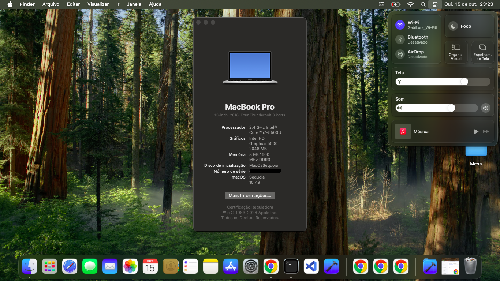

# Dell Vostro 14 5480 — OpenCore EFI (macOS Sequoia)

Working OpenCore EFI for the **Dell Vostro 14 5480** running **macOS Sequoia**. Nearly everything works. Shared to save others the trial-and-error.

> ⚠️ **READ THIS FIRST — you MUST generate your own SMBIOS before booting.** The `SystemSerialNumber`, `MLB`, `SystemUUID` and `ROM` in this EFI are **real serials from another machine**. Booting with these will break iMessage/FaceTime and can burn a serial. See [Setup](#setup) below.

## Hardware

| Component | Details |
|---|---|
| Model | Dell Vostro 14 5480 |
| CPU | Intel Core i7-5500U (Broadwell) |
| iGPU | Intel HD Graphics 5500 (`AAPL,ig-platform-id` = `0x16160004`) |
| dGPU | NVIDIA GeForce 830M (disabled via `disable-gpu`) |
| Audio | Realtek ALC290 (AppleALC, `layout-id` 4, patched via OpenCore Legacy Patch) |
| Wi-Fi | Intel Wireless 7265 — using **AirportItlwm** (patched via OpenCore Legacy Patch) |
| RAM | 8 GB DDR3 1600 MHz |
| Ethernet | Realtek RTL8111/8168 Gigabit (RealtekRTL8111.kext) |
| Trackpad | ELAN I2C (VoodooI2C + VoodooI2CELAN) — ✅ Working |
| SMBIOS | MacBookPro15,2 |

## What works / what doesn't

| Component | Status | Notes |
|---|---|---|
| Internal display | ✅ | Full QE/CI, Metal |
| Intel HD 5500 acceleration | ✅ | |
| Audio (speakers, mic, jack) | ✅ | AppleALC — patched via OpenCore Legacy Patch |
| HDMI / DisplayPort | ✅ | |
| **Wi-Fi** | ✅ | AirportItlwm — patched via OpenCore Legacy Patch |
| **Bluetooth** | ❌ | IntelBluetoothFirmware + IntelBTPatcher loaded but not working |
| Battery / sleep / lid | ✅ | SMCBatteryManager + ECEnabler |
| Keyboard + backlight | ✅ | VoodooPS2 |
| Trackpad gestures | ✅ | VoodooI2C + VoodooI2CELAN (ELAN) |
| CPU temp / fan sensors | ✅ | SMCDellSensors + SMCProcessor + SMCSuperIO |
| Ethernet | ✅ | RealtekRTL8111 |
| NVMe/SATA SSD | ✅ | NVMeFix |

## Setup

1.  **Generate your own SMBIOS** with [GenSMBIOS](https://github.com/corpnewt/GenSMBIOS) for `MacBookPro15,2`, then fill in `PlatformInfo > Generic`:
    -   `SystemSerialNumber`, `MLB`, `SystemUUID`
    -   `ROM` → use your machine's real Ethernet MAC (en0), or the last 6 bytes of your Wi-Fi MAC.
2.  **BIOS settings** (F2 at boot):
    -   Disable **Secure Boot**
    -   Set **SATA Operation → AHCI**
    -   Disable **CFG Lock** (or keep `AppleXcpmCfgLock` quirk enabled, which this EFI does)
    -   Set **DVMT Pre-Allocated → 64MB** or higher if possible
    -   Enable **Virtualization (VT-x)** if you want VMs
3.  Copy `EFI/` to your USB/ESP, boot, install/boot Sequoia.

## Notable fixes (the valuable bits)

### OpenCore Legacy Patch

This build uses **OpenCore Legacy Patcher** to apply additional patches required for **Audio** (Realtek ALC290) and **Wi-Fi** (Intel Wireless 7265) on newer macOS versions. OCLP provides pre-built kexts and patches for features like audio and Wi-Fi on unsupported hardware.

### Wi-Fi (Intel Wireless 7265) — AirportItlwm

This EFI uses **AirportItlwm.kext** for the Intel Wireless 7265 card. The `Kernel > Block` entry excludes `IOSkywalkFamily` for kernel versions `23.0.0` to `25.99.99`, which is required to allow the legacy 802.11 family to load alongside Itlwm on newer macOS versions.

### Bluetooth (Intel) — Not working

This EFI includes `IntelBluetoothFirmware.kext`, `IntelBTPatcher.kext` and `BlueToolFixup.kext`, but **Bluetooth does not work** on this hardware with current macOS versions. The Intel BCM20702/20703 stack is incompatible with newer Bluetooth implementations.

### CPU Power Management (U-series)

`DummyPowerManagement` is **disabled** in this EFI because the i7-5500U (Broadwell) is handled differently than Kaby Lake. Combined with `SMCProcessor.kext` and `SMCDellSensors.kext`, this provides proper fan control, thermal sensors, and CPU frequency scaling.

### SSD

Primary drive: **SanDisk SSD PLUS 480GB** (SATA). `NVMeFix.kext` prevents kernel panics on sleep/wake.

## Kexts

| Kext | Purpose |
|---|---|
| Lilu | Base patcher |
| VirtualSMC | SMC emulation |
| SCBatteryManager | Battery sensing |
| SMCDellSensors | Dell-specific sensors/fan control |
| SMCProcessor | CPU sensors |
| SMCLightSensor | Ambient light sensor |
| SMCSuperIO | Fan RPM / hardware monitoring |
| WhateverGreen | iGPU patching |
| AppleALC | Audio patching |
| AirportItlwm | Intel Wi-Fi |
| IO80211FamilyLegacy | Native Wi-Fi fallback |
| IOSkywalkFamily | Network stack (blocked for downgrade) |
| RestrictEvents | Hardware restriction fixes |
| BlueToolFixup | Bluetooth fix for Monterey+ |
| IntelBluetoothFirmware | Intel BT firmware |
| IntelBTPatcher | Intel BT patcher |
| RealtekRTL8111 | Realtek Gigabit Ethernet |
| NVMeFix | NVMe/SATA sleep fix |
| ECEnabler | EC polling fix |
| VoodooPS2Controller | Keyboard |
| VoodooInput | Trackpad input support |
| VoodooI2C | I2C trackpad controller |
| VoodooI2CELAN | ELAN I2C trackpad driver |
| BrightnessKeys | Function key brightness controls |
| USBMap | USB port map |

> **Kext versions matter.** VirtualSMC plugins must match VirtualSMC's version. When updating macOS, update Lilu + all Lilu-based kexts together.

## ACPI (SSDTs)

| SSDT | Purpose |
|---|---|
| SSDT-ALS0.aml | Ambient light sensor |
| SSDT-EC-LAPTOP.aml | Embedded Controller stub |
| SSDT-HPET.aml | HPET fix + `_STA`/`_CRS` to `XSTA`/`XCRS` rename |
| SSDT-PLUG.aml | XPU plugin for power management |
| SSDT-PNLF.aml | Backlight control |
| SSDT-RHUB.aml | USB reset |
| SSDT-USB-Reset.aml | USB port reset |
| SSDT-USBX.aml | USB power injection |
| SSDT-XOSI.aml | OS identification patches (Windows → macOS) |

### ACPI Patches

-   HPET `_STA` → `XSTA` Rename (disabled)
-   HPET `_CRS` → `XCRS` Rename
-   IPIC IRQ 2 Patch (disabled)
-   RTC IRQ 8 Patch (disabled)
-   TIMR IRQ 0 Patch (disabled)
-   `_OSI` → `XOSI` rename (2 patches enabled)

## NVRAM

Boot args: `keepsyms=1 amfi=0x80 ipc_control_port_options=0`

CSR active config: `0x000A` (allows `CSR_ALLOW_UNTRUSTED_KEXTS` + `CSR_ALLOW_UNAPPROVED_KEXTS`)

Custom NVRAM entries:
-   `revcpu` = 1, `revcpuname` = "Intel® Core™ i7-5500U", `revpatch` = "cpuname,diskread" (CPU name spoofing in About This Mac)

## Credits

Based on the work of [Acidanthera](https://github.com/acidanthera), [OpenIntelWireless](https://github.com/OpenIntelWireless), [VoodooI2C](https://github.com/VoodooI2C/VoodooI2C), and the Hackintosh community.

---

*Provided as-is. Always generate your own SMBIOS. Not affiliated with Apple or Dell.*
